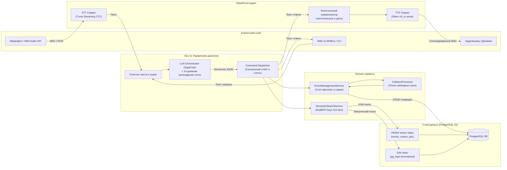

# Gorky: Voice Assistant for Tasks & Events

Интеллектуальный голосовой и текстовый ассистент для управления расписанием, задачами и встречами с поддержкой естественной русской речи. Система извлекает темпоральные сущности с привязкой к динамической календарной сетке, разрешает конфликты расписания с автоматическим подбором свободных окон, поддерживает серии повторяющихся событий и осуществляет гибридный семантический поиск по базе записей.

**Работающий прототип:** [https://washhouse-angles-sepia.ngrok-free.dev](https://washhouse-angles-sepia.ngrok-free.dev) 

---

## 1. Как пользоваться

Взаимодействие доступно через веб-интерфейс (голосовая запись по кнопке микрофона и текстовый чат) либо через интерактивный CLI.

| Запрос пользователя | Действие системы | Тип сценария / Извлеченные данные |
| :--- | :--- | :--- |
| «Напомни мне завтра в 10 утра позвонить Ивану» | Создание напоминания на следующий день в 10:00 | Базовый: `create_event` (`reminder`, абсолютное время, относительная дата) |
| «В четверг в 11 у меня встреча с дизайнером» | Фиксация встречи в ближайший четверг в 11:00 | Базовый: `create_event` (`meeting`, день недели) |
| «Поставь встречу с Иваном завтра» | Вопрос: «На какое время запланировать встречу?» -> Ответ: «В 15:00» -> Создание записи | Уточняющий диалог: `clarify` (сохранение названия в `partial_data`, добор времени) |
| «Что запланировано на эту неделю?» | Вывод упорядоченного списка дел с понедельника по воскресенье | Базовый: `list_events` (календарный период текущей недели) |
| «Есть ли у меня планы в пятницу утром?» | Фильтрация событий на пятницу в интервале 06:00–12:00 | Расширенный: `list_events` (дата + фильтр времени суток) |
| «Когда у меня была встреча с Иваном?» | Вывод последней прошедшей встречи с указанием даты | Семантический поиск: `search_events` (ранжирование по релевантности) |
| «Я когда-то ставил задачу по договору, найди её» | Поиск записей по смыслу без точного словарного совпадения | Семантический поиск: векторное сходство через RuBERT-tiny2 |
| «Поставь созвон с командой завтра в 14:00» *(при занятом слоте)* | Предупреждение о коллизии и предложение: «Предлагаю перенести на 14:30. Подходит?» | Детекция конфликтов: `CollisionProcessor` с шагом поиска 30 минут |
| «Повторяй эту планёрку каждую неделю» | Генерация регулярной серии событий с единым `series_id` | Повторяющиеся задачи: `recurrence="weekly"` |
| «Перенеси её на пятницу» -> «Отметь выполненной» | Модификация и закрытие контекстной задачи без повторного ввода имени | Мультидиалог: удержание контекста последней сущности (`session_id`) |

---

## 2. Соответствие требованиям задания

### Обязательные требования

| Требование ТЗ | Статус | Реализация в кодовой базе |
| :--- | :---: | :--- |
| Создание задачи и напоминания | Реализовано | `backend/services/event_management.py`, `backend/ai_service/llm/prompts.py` |
| Создание встречи | Реализовано | `backend/dal/nlp_utils.py` (классификатор `classify_event`), `EventManagementService` |
| Список задач и встреч за период | Реализовано | `backend/services/command_dispatcher.py` (`ListEventsHandler`), `EventRepository` |
| Поиск ранее созданной записи | Реализовано | `backend/services/semantic_search.py`, `backend/database/search_repository.py` |
| Сохранение данных между запросами | Реализовано | PostgreSQL 15, таблица `events` со строгой типизацией |
| Голосовой ввод и голосовой ответ | Реализовано | STT: `backend/ai_service/stt/tone.py`; TTS: `backend/ai_service/tts/silero.py` |

### Дополнительные возможности

| Возможность | Статус | Особенности реализации |
| :--- | :---: | :--- |
| Изменение и удаление задач голосом | Реализовано | Обработчики `update_event`, `delete_event`, поддержка каскадного удаления (`scope="one" \| "series" \| "all"`) |
| Отметка задачи выполненной | Реализовано | Действие `complete_event`, перевод в статус `completed`, исключение из расчета коллизий |
| Обработка конфликтующих встреч | Реализовано | Модуль `CollisionProcessor`: обнаружение пересечений интервалов + автоподбор свободного окна (+30 мин) |
| Повторяющиеся задачи и встречи | Реализовано | Полноценная поддержка серий (`daily`, `weekly`, `monthly`) с генерацией UUID `series_id` |
| Контекст диалога («А перенеси ее на завтра») | Реализовано | Кэширование контекста в `EventManagementService` (`_last_ids`, `_pending`), связывание местоимений с объектом |
| Семантический поиск по старым задачам | Реализовано | Локальные эмбеддинги `cointegrated/rubert-tiny2` (312 dim) + векторный индекс HNSW (`vector_cosine_ops`) |
| Неоднозначные запросы и уточняющий диалог | Реализовано | Двухфазный слот-филлинг через действие `clarify`: сохранение `partial_data` без сброса контекста |
| Интеграция с внешним календарем | Спроектировано | Модуль экспорта событий в формат iCalendar (RFC 5545) и протокол CalDAV (см. раздел векторов развития) |

---

## 3. Результаты замеров качества (Бенчмарки)

Тестирование NLU-пайплайна проводилось на валидационном корпусе из 110 размеченных эталонных запросов 

### 1. Ключевые метрики NLU

| Метрика | Значение | Описание |
| :--- | :---: | :--- |
| **Intent Accuracy** | **98.2%** | Точность классификации интента пользователя (108 из 110) |
| **Intent Macro-F1** | **0.994** | Невзвешенное среднее гармоническое F1 по всем 6 ключевым действиям |
| **Slot Exact Accuracy** | **82.0%** | Доля полностью и точно извлеченных слотов (109 из 133 слотов) |
| **Slot Precision / Recall / F1** | **0.858 / 0.820 / 0.838** | Оценка точности извлечения ключевых параметров даты, времени и сути |
| **Задержка ответа (p50 / p95)** | **507.9 мс / 894.1 мс** | Время инференса LLM и обработки диспетчером |
| **Fallback (невалидный JSON)** | **0** | Ни одного сбоя структуры схемы ответа благодаря строгому промптингу |

### 2. Результаты классификации по интентам

| Интент | Успешно | Всего | Точность (Accuracy) |
| :--- | :---: | :---: | :---: |
| `create_event` | 28 | 30 | 93.3% *(2 кейса переведены в штатный `clarify`)* |
| `update_event` | 15 | 15 | 100.0% |
| `delete_event` | 13 | 13 | 100.0% |
| `complete_event` | 12 | 12 | 100.0% |
| `search_events` | 20 | 20 | 100.0% |
| `list_events` | 20 | 20 | 100.0% |

### 3. Эффективность семантического поиска (RuBERT-tiny2 + pgvector)

Тестирование проводилось на корпусе из **1000 реальных событий** организаторов (`data/cleaned_events_1000.csv`):
- **Recall@1**: 75.0%
- **Recall@3**: 85.0%
- **Mean Reciprocal Rank (MRR)**: 0.792
- **Время векторизации всего корпуса (1000 записей)**: 5.34 с на CPU
- **Задержка поиска по вектору (query latency)**: p50 = 7.2 мс, p95 = 44.4 мс

---

## 4. Архитектура системы

### Потоковая схема обработки запроса



### Описание функциональных слоев

- **Аудио-слой (STT & TTS)**:
  - **STT**: Локальная потоковая CTC-модель `t-tech/T-one` (8 кГц). Работает непосредственно на сервере без отправки голосовых данных во внешние контуры.
  - **TTS**: Нейросетевой синтез на базе `snakers4/silero-models` (голос `xenia`, 24 кГц). Модуль `backend/text_normalizer.py` выполняет развертывание числовых дат, времени и диапазонов в словесные формы согласно правилам русской грамматики.
- **NLU-оркестрация и извлечение сущностей**:
  - Перед отправкой запроса в GigaChat строится контекст текущей сессии: локальная временная метка, день недели, таймзона и 14-дневная календарная сетка с абсолютными датами.
  - Формат вывода жестко детерминирован схемой Pydantic (`action`, `data`, `reply_text`).
  - При отсутствии параметров запускается процедура `clarify`, где система удерживает уже известные слоты в `partial_data` и задает один точечный вопрос пользователю.
- **Диспетчеризация и бизнес-логика**:
  - `CommandDispatcher` распределяет управление по зарегистрированным обработчикам `BaseActionHandler`.
  - `CollisionProcessor` вычисляет пересечения отрезков времени `[start_time, end_time]` и генерирует доступные альтернативные слоты со смещением +30 минут в рамках того же рабочего дня.
  - `EventManagementService` управляет сериями повторяющихся событий (`series_id`), а также сценариями подтверждения и отмены действий.
- **Слой персистентности и векторного поиска**:
  - PostgreSQL 15 с расширениями `pgvector` и `pg_trgm`.
  - Поиск кандидатов выполняется по гибридному принципу: векторное сканирование по индексу HNSW (`rubert-tiny2`, 312 dim) с отсечением по косинусному порогу (`TTV_MIN_SIMILARITY >= 0.80`) в сочетании с полнотекстовым триграммным анализом лемматизированных форм (`pymorphy3`).

---

## 5. Технологический стек

| Слой системы | Технология / Библиотека | Обоснование выбора |
| :--- | :--- | :--- |
| **Backend Core** | Python 3.11+, FastAPI | Асинхронная неблокирующая обработка запросов, строгая валидация контрактов данных через Pydantic v2. |
| **Frontend UI** | Reflex 0.10.1 (React, Radix UI, Tailwind CSS v4) | Реактивный full-stack фреймворк на Python: быстрый рендеринг календаря и чата, двусторонние WebSockets. |
| **Speech-to-Text (STT)** | `t-tech/T-one` (Streaming CTC) | Локальный инференс, низкая задержка на коротких фразах, точность распознавания русской речи, работа в закрытом контуре. |
| **Text-to-Speech (TTS)** | Silero TTS (`v5_ru`, голос `xenia`) | Качественный нейросетевой синтез на CPU без потребности в GPU, независимость от клиентской ОС и браузера. |
| **LLM / NLU** | GigaChat API (`GigaChat-3-Lightning`) | Высокая точность извлечения русских темпоральных конструкций, официальная доступность в РФ, поддержка Structured Output. |
| **Embeddings** | `cointegrated/rubert-tiny2` | Сверхкомпактная модель (312 dim): векторизация запроса за 7 мс на CPU, высокая плотность семантики. |
| **База данных** | PostgreSQL 15 + pgvector + pg_trgm | Объединение реляционной транзакционности, векторного индекса HNSW и триграммного поиска без внешних баз. |
| **Морфология** | `pymorphy3` | Нормализация слов русского языка к леммам для устойчивой триграммной индексации. |
| **Audio Processing** | Web Audio API, MediaRecorder, sounddevice | Потоковая запись звука с микрофона в браузере и на хосте с динамической визуализацией волны. |
| **Инфраструктура** | Docker, Docker Compose | Воспроизводимость развертывания окружения БД и сервисов одной командой. |

---

## 6. Требования к окружению и установка

### Системные требования
- **ОС**: Linux (Ubuntu 22.04+), macOS (13+), Windows с WSL2.
- **Python**: 3.11 или 3.12.
- **Node.js**: 18+ (необходим для сборки фронтенда Reflex).
- **Docker & Docker Compose**: для запуска базы данных PostgreSQL с векторным расширением.
- **Системные зависимости**: `ffmpeg` и `portaudio` (для аудио-пайплайна).

Установка системных зависимостей:
```bash
# macOS
brew install portaudio ffmpeg

# Ubuntu / Debian
sudo apt-get update && sudo apt-get install -y portaudio19-dev ffmpeg libsndfile1
```

### Пошаговый запуск

1. **Клонирование репозитория:**
   ```bash
   git clone https://github.com/Artem-Gorev/Voice-Assistant.git
   cd Voice-Assistant
   ```

2. **Создание виртуального окружения:**
   ```bash
   python3.11 -m venv .venv
   source .venv/bin/activate
   ```

3. **Установка Python-зависимостей:**
   ```bash
   pip install --upgrade pip setuptools wheel
   pip install -r requirements.txt
   ```

4. **Конфигурация окружения (.env):**
   ```bash
   cp .env.example .env
   ```
   Укажите ваш ключ `GIGACHAT_CREDENTIALS` в файле `.env`.

5. **Запуск базы данных PostgreSQL (pgvector):**
   ```bash
   docker compose up -d postgres
   ```
   Схема базы данных `backend/database/schema.sql` инициализируется автоматически.

6. **Импорт стартового датасета (1000 событий):**
   ```bash
   python backend/database/etl_migration.py
   ```

7. **Запуск веб-интерфейса и бэкенда:**
   ```bash
   reflex run
   ```
   - Веб-интерфейс: `http://localhost:3000`
   - API бэкенда: `http://localhost:8000` (Swagger: `http://localhost:8000/docs`)

8. **Альтернативный запуск в терминале (CLI-режим):**
   ```bash
   # Текстовый диалог
   python scripts/run_assistant_pipeline.py

   # Голосовой режим с распознаванием микрофона и озвучкой ответов
   python scripts/run_assistant_pipeline.py --voice-input --voice-output
   ```

---

## 7. Принятые инженерные решения, ограничения и масштабирование

### Принятые архитектурные решения

1. **Строгая типизация контрактов LLM (Structured JSON Output):**
   Отказ от неструктурированного текста в пользу фиксированных контрактов исключил сбои парсинга (0 fallback-ошибок на 110 тестовых сценариях). Модель выполняет только NLU-роль (распознавание намерения и выделение слотов), тогда как исполнение, проверка бизнес-правил и сохранение строго делегированы детерминированному Python-коду.
2. **Динамическая 14-дневная сетка в контексте:**
   Для устранения ошибок при обработке относительных дат («послезавтра», «в следующую среду») в системный промпт инжектируется предрассчитанный календарь на две недели вперед с абсолютными датами. Это гарантирует строгое формирование отметок времени в формате ISO 8601.
3. **Автоподбор слотов при коллизиях (Collision Resolution):**
   В отличие от систем, выдающих только предупреждение об ошибке, модуль `CollisionProcessor` вычисляет временной интервал конфликта и автоматически ищет ближайшее свободное 30-минутное окно, предлагая его пользователю в естественном диалоге.
4. **Гибридный поиск (RuBERT-tiny2 + HNSW + pg_trgm):**
   Семантические векторы размерности 312 находят записи по смыслу («визит к врачу» -> «созвон с терапевтом»), а лемматизация через `pymorphy3` с триграммным индексом страхует от искажений в распознавании речи.

### Текущие ограничения и пути масштабирования (Production Trade-offs)

| Текущее решение в прототипе | Инженерная причина / Ограничение | Как масштабировать в Production |
| :--- | :--- | :--- |
| **Векторизация RuBERT-tiny2 на CPU внутри приложения** | Локальный инференс без GPU, компактность образа, экономия оперативной памяти | Вынос в микросервис векторизации (Triton / TorchServe) с поддержкой батчинга на GPU; асинхронный расчет векторов через брокер сообщений (RabbitMQ / Redis Streams). |
| **STT T-one на сервере приложения** | Обеспечение работы без внешних платных облачных API на одном инстансе | Вынос STT в распределенный кластер инференса за gRPC-балансировщиком с масштабированием по CPU/GPU worker nodes. |
| **Синтез Silero TTS целиком после генерации ответа** | Ожидание полного текста перед запуском синтеза аудио | Потоковый (streaming) TTS: разбиение ответа по знакам препинания на синтагмы и передача первых аудиочанков в браузер (Time to First Audio < 400 мс). |
| **Прямое соединение с БД без пула соединений** | Достаточно для однопользовательского режима и локального запуска | Внедрение PgBouncer для управления пулом соединений при высоких нагрузках; шардирование таблицы `events` по `user_id`. |
| **In-memory хранение стейта диалога (`_pending`, `_last_ids`)** | Быстродействие и простота реализации в рамках хакатона | Вынос контекста сессий в Redis с TTL, что позволит масштабировать бэкенд на множество stateless-контейнеров. |

### Что улучшили бы при наличии дополнительного времени

1. **Двусторонняя интеграция с Google Calendar и CalDAV:**
   Реализация OAuth2 авторизации для двусторонней синхронизации внешних календарей с разрешением конфликтов версий.
2. **Полнодуплексный режим диалога (Full-Duplex WebRTC + Silero VAD):**
   Отказ от ручного нажатия кнопки записи в пользу автоматической детекции голоса (VAD) и возможности прерывания речи ассистента в любой момент (Barge-in).
3. **Многопользовательский контур и безопасность:**
   Разграничение доступа на базе JWT-токенов, сквозное шифрование текстов задач и ролевая модель доступа к общим встречам.
4. **Локальный NLU на квантованных LLM:**
   Подключение компактных локальных моделей (например, Vikhr-7B или Qwen2.5-7B в формате GGUF/AWQ через vLLM) для полностью автономного функционирования в закрытом периметре без доступа к внешней сети.
